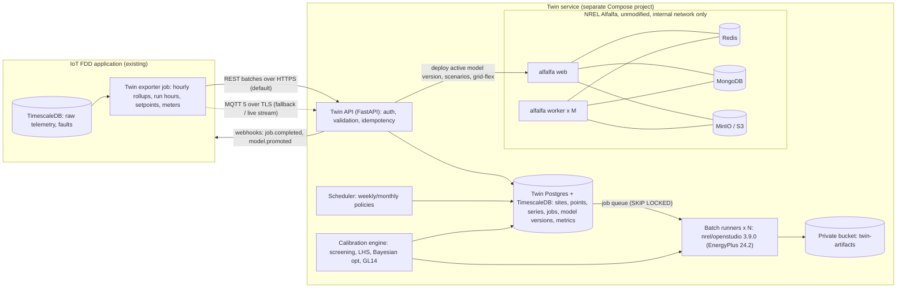

# Critique and plan: continuous Guideline 14 digital twin on NREL Alfalfa

**Verdict: GO** — conditional on the architecture correction in this document.

Reasons, short:

1. **The repo uses Alfalfa the way NREL intends.** The default stack runs the official, digest-pinned `web` and `worker` images and includes the upstream Compose file without changes. Custom code only calls the official REST API through `alfalfa-client`. I re-verified this on Linux: the 3 unmodified upstream integration tests pass, and 44 of 44 audited web and worker source files match upstream. It is not a custom reimplementation, apart from one legacy prototype that must be deleted (finding P2-1).
2. **None of the required product exists yet.** There is no multi-site support, no calibration, no Guideline 14 metrics, no meter ingestion and no measured weather. The custom FastAPI app is a single-day demo bound to an upstream test model. Keep the deployment skeleton (Compose include, digest pins, source audit, upstream test profile) and replace the app.
3. **Alfalfa must not be the calibration engine.** Alfalfa steps EnergyPlus at a fixed 1-minute timestep and only runs paced by wall-clock time or by external `advance` calls. Measured on this repo's stack, a simulated year takes about 16 hours with external-clock stepping and about 3 hours at the fastest stable timescale. The same model, in the same official image, runs a year in batch EnergyPlus in **12 seconds**. Calibration and annual ROI runs therefore need a batch runner on the same engine version: the official `nrel/openstudio:3.9.0` image, which bundles EnergyPlus 24.2.0, the same version as the pinned Alfalfa worker. Alfalfa stays the runtime for the live twin, control what-ifs and sub-hourly grid-flexibility runs, which is what it was built for.

This becomes **NO-GO** if the product owner requires every simulation, including calibration sweeps, to run through Alfalfa. That is not feasible at weekly or monthly cadence across several sites (see the throughput table below).

---

## 1. What I actually ran (develop @ `eb72580`)

Environment: Linux VM with 4 vCPU and 15 GiB RAM, Docker 29.1, Compose v5.8. PowerShell was not available, so I reproduced the launcher's steps in bash. The VM also had stale legacy iptables rules that dropped bridge traffic. That was an environment problem, not a repo problem, and I fixed it before testing.

| Check | Result |
|---|---|
| Repo unit tests (`python -m unittest discover -s tests`) | **3/3 pass**. All three only test rejection of bad input (422s); no test covers a successful submission. |
| Pull official images, build the client, `up -d --no-build` | **Works**: web, worker, Mongo, Redis, MinIO and the client are healthy; the bucket initializer exits 0. |
| Official smoke test (`examples/alfalfa_smoke.py`) as committed | **FAILS on Linux**: `ConnectionRefused` to `kubernetes.docker.internal:9000` during the presigned S3 upload (P1-1). |
| Same smoke test with `S3_URL_EXTERNAL=http://minio:9000` (override kept outside the repo) | **Pass**: upload, preprocessing, READY, RUNNING, setpoint writes and readbacks, 1-minute advances, COMPLETE, archive downloaded. |
| Daily replay (`examples/demo.py`) | **Pass**: 96 intervals and 1,440 advances in **169 s** wall time. |
| Upstream integration tests (verification profile; schedule override and Python I/O enable/disable) | **3/3 pass** in 60 s. |
| `tools/audit_upstream.py` | **44/44 files match** upstream `af3caee`. |
| Engine inside the worker image | OpenStudio `3.9.0+c77fbb9569`, EnergyPlus `24.2.0-94a887817b`. |
| Upstream S3 bucket made private (`mc anonymous set none`), then smoke rerun | **Pass**; anonymous listing returns 403. Alfalfa uses presigned URLs, so the upstream public-bucket default is unnecessary. |
| Legacy standalone (direct EnergyPlus 26.1) prototype | Not built; it is not the default and should be deleted. |

### Throughput (same upstream `schedule_model`, 4 vCPU VM)

| Mode | Wall time per simulated day | Extrapolated per simulated year |
|---|---|---|
| Alfalfa, external clock (this repo's client: about 4 HTTP calls per simulated minute) | 169 s | **≈ 16 h** |
| Alfalfa, internal clock, timescale 600 | 144 s | ≈ 15 h |
| Alfalfa, internal clock, timescale 3,000 | 30 s | **≈ 3 h** |
| Alfalfa, internal clock, timescale 20,000 | aborted after 2 s: "Timescale too high. Simulation more than 2 timesteps behind" | — |
| Batch EnergyPlus 24.2 in the same worker image, 60 timesteps/h | — | **80 s** |
| Batch EnergyPlus 24.2 in the same worker image, 4 timesteps/h | — | **12 s** |

### Measured resource footprint

| Container | Idle RAM | While stepping |
|---|---|---|
| Alfalfa worker (1 run) | 410 MiB | **≈ 91% of one core**, 666 MiB |
| Alfalfa Mongo | 362 MiB | low CPU |
| Alfalfa MinIO | 149 MiB | low CPU |
| Alfalfa web | 88 MiB | low CPU |
| Alfalfa Redis | 11 MiB | **≈ 17% of one core** (per-step point traffic) |
| Telemetry client | 41 MiB | ≈ 8% of one core |

The Alfalfa stack idles at about 1.1 GiB. Each concurrent Alfalfa run takes about one core. Images take about 6 GB on disk.

---

## 2. Findings

### P0: blocks the product

- **P0-1. No product capability.** `app/server.py` accepts exactly 96 contiguous 15-minute rows for one 2025 day. It accepts only one `model_id`, which maps to an upstream *test fixture*. It runs one serial thread with a queue of 4 and stores state in JSON files. There is no site registry, no concept of several twin jobs per site, no history, and no model versioning.
- **P0-2. No calibration, no Guideline 14 metrics, no meter or utility ingestion, no measured weather.** Results literally return `"guideline14_compliance": "not assessed"`. The only "comparison" is a per-interval list of simulated zone temperatures next to one measured mean, with no zone mapping.
- **P0-3. Alfalfa is used for the wrong workload.** Replaying telemetry day by day through external-clock 1-minute stepping costs about 16 hours per simulated year per worker, and every replay re-uploads and re-preprocesses the model. Each submission also restarts from warmup, so there is no thermal continuity between days. Calibration needs roughly 100 to 300 annual or seasonal runs per site per recalibration; through Alfalfa that is weeks of worker time per site. Calibration must run batch, on the same engine version, outside Alfalfa.
- **P0-4. No security for any deployment beyond localhost.** The Alfalfa API has no authentication by design, and neither does the custom client API. Upstream defaults ship known credentials (`user/password`, `admin/password`) and a public bucket. There is no TLS and no tenant isolation. The README does acknowledge this, but it blocks every real deployment.

### P1: must fix early

- **P1-1. Windows-only portability.** The launcher is PowerShell-only. `S3_URL_EXTERNAL=http://kubernetes.docker.internal:9000` combined with `extra_hosts: host-gateway` only works on Docker Desktop. On Linux the host gateway is the bridge IP, MinIO is published on `127.0.0.1` only, and model upload fails (reproduced above). Make the S3 endpoint an `.env` setting and add a Linux-first launcher (Makefile or bash).
- **P1-2. Image and source version skew.** The running images match upstream `af3caee`, while the included Compose file and tests are pinned at `6c76e0b`. The images therefore lack upstream fixes #664 (web server crash on point writes with an empty body) and #642 (worker busy-spin loops). Pin images and checkout to one revision: a release tag, or images built from the pinned commit with the digest recorded.
- **P1-3. Not co-locatable as is.** The upstream Compose file hard-codes `container_name` (`alfalfa_web`, `alfalfa_mongo`, `alfalfa_redis`, `alfalfa_minio`, `alfalfa_mc`) and publishes host ports 80, 9000, 27017 and 6379. This repo narrows them to `127.0.0.1:80` and `127.0.0.1:9000`, but that still collides with any reverse proxy on port 80 of the same host, and the fixed names prevent two Alfalfa stacks per host. Deployment overlays must clear the ports (`!reset []`) and run Alfalfa on an internal network only.
- **P1-4. Alfalfa's synthetic whole-building meter point does not match EnergyPlus.** During the smoke run, `Whole Building Electricity` (units "W") stayed at 133,888 for three consecutive midnight minutes. EnergyPlus's own `eplusmtr.csv` for the same run recorded `Electricity:Facility` = 205,783 J per 1-minute step, about 3.4 kW. Do not use Alfalfa meter points for Guideline 14 metrics; compute energy from the EnergyPlus SQL or meter output. Report this upstream with a minimal reproduction instead of patching.
- **P1-5. Time handling is pushed onto the caller.** The API rejects timezone-aware timestamps and requires "local standard time, no DST", while the upstream system stores UTC in Timescale. Sites need an IANA timezone, and the service should do the UTC to local-standard-time conversion that EnergyPlus requires.
- **P1-6. No CI, and the "verified" evidence isn't reproducible.** The CI workflow was deleted. README and CHECKPOINT claims rest on logs in an ignored `work/` folder. I reproduced most claims, but only after fixing P1-1 locally.
- **P1-7. The point mapping is hard-coded** to two fixture schedule names (`CONSTANT HEATING`, `COMPACT COOLING`). There is no point or equipment model (Brick or Haystack classes), and runtime data is ignored.
- **P1-8. Restart semantics.** A client restart marks in-flight jobs failed and orphans their Alfalfa runs. Separately, upstream documents that a worker restart loses the in-memory model. The orchestrator must treat Alfalfa runs as disposable and re-creatable from versioned model artifacts.

### P2: hygiene

- **P2-1.** `app/standalone_server.py`, `Dockerfile.standalone` and `compose.standalone.yaml` are a custom direct-EnergyPlus 26.1 reimplementation that rewrites schedules into `Schedule:File`. That is exactly the non-Alfalfa path, and it uses a different engine version. Delete it. Its Dockerfile's default `CMD` also points at `app.server`, the wrong module; it only works because Compose overrides the command.
- **P2-2.** The root-level `*_experiment.py` script duplicates `examples/alfalfa_smoke.py` and is named after an external product. Delete or rename it.
- **P2-3.** The repo name ("…-energyplus-worker") and description ("EnergyPlus Docker Container") misdescribe it: it is not a worker. The git history contains unrelated projects (game-level tooling, a browser game demo, hosting configuration). Consider a fresh repo or a squashed import. `CHECKPOINT.md` is agent scratch notes.
- **P2-4.** About 80% of the code is duplicated between `server.py` and `standalone_server.py`. Importing `app.server` creates `/data` as a side effect. `requests` is unpinned and there is no lockfile.
- **P2-5.** Small README inaccuracy: `/docs` returns 200, but it serves the single-page-app HTML, not API docs; `/redoc` is the real reference. The demo payload uses constant "measured" values (24 °C, 300 s), so it can't validate anything.

---

## 3. Is this Alfalfa "as NREL intends"?

Upstream architecture, verified from the upstream source at `6c76e0b` and the wiki:

- **web** (Node.js): REST API v2 (`/api/v2/models/upload`, `/models/{id}/createRun`, `/runs/{id}/start|advance|stop|points|points/values|download`, `/aliases`, `/version`), plus the single-page UI and `/redoc`. **No authentication.**
- **worker** (Python, OpenStudio 3.9 and EnergyPlus 24.2 via `pyenergyplus`): pulls jobs from a Redis list with a blocking pop, **one job at a time per worker**, and scales by adding replicas. `CreateRun` runs the submitted OpenStudio workflow (OSW) with Alfalfa's measures merged in. `StepRun` **forces a 1-minute timestep**, rewrites RunPeriod and Timestep, and exposes points (zone temperature, humidity and setpoint; schedules as writable inputs; actuators; whole-building meters).
- **Redis**: the job queue plus live run messaging. **MongoDB**: model, run and point metadata. **S3 (MinIO locally)**: model uploads and run archives, accessed through presigned URLs.
- **Clocks**: `externalClock` (advance per API call), `timescale` (wall-clock paced, aborts when more than 2 steps behind) and `realtime`. There is no "as fast as possible" mode.
- The weather file is part of the uploaded model package, so each new weather window means a new upload.

The repo's default path conforms: official images, upstream Compose included with deployment-only overrides, official client. What it gets wrong is **workload fit**: Alfalfa is a co-simulation and virtual-building service, not a batch or parametric engine. NREL's own tools for parametric work are OpenStudio CLI batch runs (or OpenStudio Analysis/Server at scale), not Alfalfa stepping.

---

## 4. Target architecture



Roles:

- **Batch runners** do all calibration and annual what-if/ROI simulations: `openstudio run -w` in `nrel/openstudio:3.9.0`, 4–6 timesteps per hour, results read from `eplusout.sql`. Engine parity with the Alfalfa worker is enforced by a CI check that compares `energyplus --version` in both images.
- **Alfalfa** hosts the *active* calibrated model version, packaged as an Alfalfa-ready OSW with Alfalfa's measures, for three jobs. (a) Operations what-ifs that need point writes during the run: setpoint resets, schedule trims, sequences recommended by the FDD rules. (b) Sub-hourly grid-flexibility events: shed or shift at a 1-minute timestep using `timescale` mode. (c) An interactive "virtual building" with Haystack-style points mirroring the FDD point model. Runs are disposable and re-created from model versions on demand, not kept running 24/7.
- **Job queue**: a Postgres table with `SELECT … FOR UPDATE SKIP LOCKED`. No Celery or extra broker, and runners can live on another machine.

### How Alfalfa's MongoDB, S3 and Redis coexist with a Timescale upstream

- Alfalfa's MongoDB, Redis and MinIO are **private implementation details of Alfalfa**: run and point metadata, its job queue, model and run archives. Nothing outside Alfalfa reads or writes them, and they are **not a system of record**. If they are lost, active models are re-uploaded from the twin's model versions.
- The twin's system of record is its **own** Postgres + TimescaleDB, separate from the FDD app's database. Calibration-grade data (hourly rollups) is small: about 4–5 M rows per site-year at 500 points.
- Artifacts (model versions, weather files, SQL outputs, calibration traces) go in a **private** `twin-artifacts` bucket with its own access key. That bucket can live in the same MinIO, but Alfalfa's bucket must also be made private (verified to work above).
- Backups: twin Postgres and the `twin-artifacts` bucket only.
- **Acceptable? Yes.** The three extra stateful containers cost about 0.5 GiB RAM, sit on an internal network, and hold only rebuildable data. The cost is operational: three more images to patch, and Alfalfa upgrades done as a whole-stack blue/green switch.

---

## 5. Data sharing between the IoT FDD app and this service

Context: the FDD app keeps raw HVAC telemetry (1–5 minute polling, long format: site, equipment, point, timestamp, value), fault events and SQL-derived analytics (run hours, inferred setpoints) in TimescaleDB, probably on another machine. It may later add utility and meter data. Calibration needs **hourly** data; raw 1–5 minute data is needed only for grid-flexibility validation. **Default transfer unit: hourly rollups** (mean, min, max, count, on-fraction) computed in the FDD app with Timescale continuous aggregates, plus derived features and meters. Raw data is sent only for points explicitly flagged in the point map.

### Options compared (remote deployment)

| | (a) REST push of batches | (b) Redis Streams / pub/sub | (c) S3/MinIO Parquet drop | (d) Read-only Timescale replica or SQL pull | (e) MQTT 5 |
|---|---|---|---|---|---|
| **Delivery semantics** | At-least-once with client retry; idempotent via `batch_id`. Synchronous 4xx on bad data. | Streams: at-least-once with consumer groups and XACK. Pub/sub: **at-most-once**, so messages are lost while the subscriber is down. | At-least-once (object per batch plus manifest); no synchronous validation. | Pull is exactly what the query returns; the twin keeps a watermark. | QoS 1 at-least-once with persistent sessions; QoS 2 is costly. Idempotency still required. |
| **Months of backfill** | Good with a presigned Parquet upload endpoint. | Poor: the stream is a buffer, not a store, and MAXLEN trimming loses history. | **Excellent** (columnar, compressed). | **Excellent** (query any range). | Poor: per-message size limits, and the broker is a buffer, not a store. |
| **Latency** | Minutes (batch cadence). | Sub-second. | Minutes to hours. | Polling interval. | **Sub-second**, with store-and-forward. |
| **Network and NAT** | Outbound HTTPS from the FDD host only. | Needs a Redis port reachable across machines (risky). | Outbound HTTPS to S3. | **Inbound** connection into the FDD database: the worst exposure. | Outbound TLS to the broker; NAT-friendly; client buffers offline. |
| **Security** | TLS through a reverse proxy, OAuth2 client-credentials or mTLS, site-scoped keys; the FDD app controls exactly what leaves. | Redis ACLs plus TLS exist but are rarely run well across a WAN; no per-message authorization. | Bucket policy plus presigned URLs, per-site prefixes. | Twin holds DB credentials into the FDD app; schema coupling; query load on the FDD database. | TLS plus client certificates, per-site topic ACLs (`fdd/v1/{site_id}/#`). |
| **Failure modes** | Twin down: FDD retries with backoff from its own DB, so there is no data loss. Poison payload: synchronous 422. | Consumer down: stream grows until memory pressure; on pub/sub, data is lost. | Partial uploads, missing manifests, orphaned files; errors surface late. | Long queries starve the FDD database; schema changes break the twin silently. | Broker down: client queue fills. Poison message: needs an ack/dead-letter topic. Retained-message mistakes. |
| **Ops burden** | Lowest: the twin API exists anyway. | Medium: separate hardened Redis. | Low to medium. | Medium on the FDD side (replica or roles). | Medium: broker HA, certificates, ACLs. |
| **Fit with Alfalfa** | Neutral (twin API → twin DB). | **Do not reuse Alfalfa's Redis** (see the co-location section). | Natural if the twin bucket shares MinIO; never Alfalfa's bucket. | None. | None native (Alfalfa is REST plus internal Redis); the twin's ingest worker subscribes. |
| **Multi-site** | Path-scoped (`/v1/sites/{site_id}/…`) plus key scopes. | Stream per site. | Prefix per site. | Row filter per site. | **Topic per site**, with ACLs. |

**MQTT, weighted properly.** MQTT is the most natural *streaming* transport for an IoT system. It is outbound-only, works through NAT, buffers through link drops, carries little per-message overhead, and is bidirectional, so the twin can publish `job.completed` and grid-flex event signals back to the FDD app. If the FDD gateways already speak MQTT, adding a twin topic tree costs little. Its weaknesses for *this* product are bulk backfill of months of data, synchronous validation feedback, and the extra broker to run and secure. It is therefore the **recommended fallback, and the preferred channel for live sync in Phase 8**, not the bulk path.

### Recommendation

- **Default (remote and co-located): (a) REST push**, with gzip JSON for incremental batches (hourly, or every 15 minutes) and a presigned **Parquet upload** for backfill, both behind the same `/v1` contract. The FDD app keeps ownership of its data, the contract is identical whichever host the twin runs on, and errors surface synchronously.
- **Fallback: (e) MQTT 5 over TLS**, with exactly the same JSON batch bodies as message payloads. Topics are `fdd/v1/{site_id}/telemetry|meters|features`, with replies on `twin/v1/{site_id}/acks|events`. Use QoS 1, `clean_start=false` with a session expiry of at least 24 h, and user properties `schema_version` and `batch_id`. Use it when HTTPS from the FDD host is unreliable or NAT-constrained, and for live twin sync and grid-flex later.
- **Not recommended:** Redis pub/sub (lossy), cross-machine Redis Streams, and an inbound SQL pull into a remote FDD database. Parquet drop is folded into (a) as the backfill mechanism.

### Payload schema (shared by REST bodies and MQTT payloads)

All timestamps are RFC 3339 **UTC**. The site's IANA timezone is sent once at registration, and the twin converts to the local standard time EnergyPlus needs. Units are explicit, SI preferred. `schema_version` is semver.

```json
{
  "schema_version": "1.0",
  "kind": "telemetry",
  "batch_id": "6f1b5d0e-2b7a-4c1e-9c51-1d2f3a4b5c6d",
  "site_id": "site-a",
  "generated_at": "2026-11-26T23:00:00Z",
  "resolution": "PT1H",
  "records": [
    {"point_id": "ahu-1/supply-fan-status", "ts": "2026-11-26T21:00:00Z",
     "mean": 0.92, "min": 0, "max": 1, "count": 12, "unit": "1", "quality": "ok"},
    {"point_id": "ahu-1/supply-air-temp", "ts": "2026-11-26T21:00:00Z",
     "mean": 13.1, "min": 12.6, "max": 13.8, "count": 12, "unit": "degC", "quality": "ok"}
  ]
}
```

```json
{
  "schema_version": "1.0", "kind": "meters", "batch_id": "…", "site_id": "site-a",
  "records": [
    {"meter_id": "elec-main", "fuel": "electricity", "unit": "kWh",
     "start": "2026-11-26T21:00:00Z", "end": "2026-11-26T22:00:00Z", "value": 41.7, "estimated": false},
    {"meter_id": "gas-main", "fuel": "natural_gas", "unit": "therm",
     "start": "2026-10-01T05:00:00Z", "end": "2026-11-01T05:00:00Z", "value": 812.0, "estimated": false, "billing": true}
  ]
}
```

```json
{
  "schema_version": "1.0", "kind": "features", "batch_id": "…", "site_id": "site-a",
  "run_hours": [
    {"equipment_id": "ahu-1", "period": "week", "start": "2026-11-16T06:00:00Z", "end": "2026-11-23T06:00:00Z",
     "hours": 61.5, "method": "sql:status>0.5", "source_points": ["ahu-1/supply-fan-status"]}
  ],
  "setpoints": [
    {"target_id": "vav-2-07", "kind": "zone_cooling_occupied", "unit": "degC", "value": 23.5,
     "source": "inferred", "method": "mean(zone_temp | fan_on)", "confidence": 0.8,
     "valid_from": "2026-11-01T05:00:00Z", "valid_to": "2026-12-01T06:00:00Z",
     "profile": {"weekday": [26,26,26,26,26,26,24,23.5,23.5,23.5,23.5,23.5,23.5,23.5,23.5,23.5,23.5,23.5,24,26,26,26,26,26],
                 "weekend": [26,26,26,26,26,26,26,26,26,26,26,26,26,26,26,26,26,26,26,26,26,26,26,26]}}
  ],
  "faults": [
    {"fault_id": "f-901", "equipment_id": "ahu-1", "rule_id": "economizer-stuck-closed", "severity": "high",
     "start": "2026-11-10T14:00:00Z", "end": "2026-11-12T09:00:00Z", "exclude_from_calibration": true}
  ]
}
```

Envelope limits: at most 5 MB compressed or 100k records per batch; larger loads go through Parquet upload. Parquet columns mirror `records` (`point_id`, `ts` as `timestamp[us, UTC]`, `mean`, `min`, `max`, `count`, `unit`, `quality`). An ack carries `{batch_id, accepted, rejected:[{index, reason}], received_at}`.

---

## 6. Co-located option: sibling containers on the FDD host

Anonymized profile of the FDD host: one Linux host running Docker Compose with a Python FastAPI backend, a web UI, a TimescaleDB/Postgres container, and a TLS reverse proxy; sign-in is through an external identity provider. Telemetry is polled every 1–5 minutes per point, months to a year of history per site live in long-format hypertables plus fault tables, and SQL or pandas fault rules run on a schedule. The host is modest today and can be scaled up.

### Handoff choices on a shared Docker network

- **Redis (Streams or pub/sub) as the container-to-container handoff: no.**
  - **Never reuse Alfalfa's Redis.** It is Alfalfa's job queue (a list consumed by blocking pops) and live run channel. It has no authentication by default, and upstream may change its keys or flush it on upgrade. Anyone who can write to it can inject Alfalfa jobs. A growing stream would compete for memory with Alfalfa's queue, which ran at about 17% of a core per stepping run in testing.
  - A **separate** Redis (AOF on, ACLs, `maxmemory-policy noeviction`) with Streams would work, but it adds a broker that is not a store. History beyond MAXLEN must be re-read from Timescale anyway, so it buys little over REST or SQL on one host. Pub/sub is lossy and ruled out.
- **Direct read-only SQL to the sibling Timescale container: a good secondary path on one host.**
  - Expose only versioned views (`twin_export_v1.hourly_points`, `.meters`, `.run_hours`, `.setpoints`, `.faults`) built on continuous aggregates, never raw hypertables.
  - Role setup: `CREATE ROLE twin_reader LOGIN CONNECTION LIMIT 4; ALTER ROLE twin_reader SET default_transaction_read_only = on; ALTER ROLE twin_reader SET statement_timeout = '60s'; GRANT USAGE ON SCHEMA twin_export_v1 …; GRANT SELECT ON ALL TABLES IN SCHEMA twin_export_v1 …;`, with `pg_hba` limited to the twin network subnet.
  - Pros: zero-copy backfill and no exporter code.
  - Cons: schema coupling (mitigated by the versioned views), query load on the FDD database, and a credential into the FDD database. Use it as a **backfill accelerator and optional pull mode**, not as the only contract.
- **Shared volume with Parquet files: only for one-off bulk backfill.**
  - Write `…/site=<id>/kind=<k>/date=<d>/part-<uuid>.parquet.tmp`, then do an atomic rename and write a `_manifest.json`.
  - Cons: UID/GID ownership, no authentication boundary beyond the filesystem, no backpressure, unclear cleanup ownership, and it doesn't survive a move to separate hosts (and NFS is worse).

### Resource headroom and sizing

Measured above: the Alfalfa stack idles at about 1.1 GiB, and each concurrent Alfalfa run takes about one core and 0.7 GiB. A batch annual run takes 12 s for the small fixture at 4 timesteps per hour. Real multi-zone AHU/VAV/plant models are typically **1–3 minutes and 0.3–1.5 GiB** per run; that is an estimate to benchmark in Phase 3. Calibration budget at about 200 runs per site per recalibration is **3–10 core-hours per site**.

| Load | Calibration compute | Notes |
|---|---|---|
| 5 sites, monthly | 15–50 core-h per month | Fits in a 2-core nightly cap. |
| 20 sites, weekly full recalibration | 260–870 core-h per month | Better: weekly tracking plus monthly recalibration, as in section 8. |
| 50 sites, monthly recalibration plus weekly tracking | 150–500 core-h per month, plus about 25 core-h per month of tracking | About 6 cores for 3–9 h per night. |

The FDD side needs TimescaleDB RAM (about 25% of RAM for `shared_buffers`, plus the chunk working set), CPU for continuous aggregates and fault rules, and fast disk.

**Recommended host sizes:**

- **Pilot, up to 5 sites, co-located:** ≥ 8 vCPU, 32 GB RAM, 500 GB NVMe. FDD reserved 4 vCPU and 16 GB; twin capped at 3 vCPU and 10 GB (1 Alfalfa worker, 2 runners).
- **Production, 10–50 sites, co-located:** 16–24 vCPU, 64 GB RAM, 1–2 TB NVMe, ideally with **twin data on a separate disk**. FDD reserved 6–8 vCPU and 24 GB; twin capped at 8–12 vCPU and 28 GB (2 Alfalfa workers, 6–8 runners).
- **Today's modest host:** run only the twin API, its database and Alfalfa with one worker, and cap calibration runners at 2 cores at night. Better, put the runners on a separate machine; they pull jobs from the queue, so moving them is a configuration change.

### Isolation so calibration cannot starve the FDD app

- **Separate Compose project** (`name: twin`), with its own lifecycle, upgrades and `down`.
- **Shared external network** `fdd_twin` carrying only the twin API (and `twin_reader` access to Timescale if used). Alfalfa, the twin database and the runners stay on `twin_internal`. Alfalfa publishes **no host ports** (`!reset []`), and the TLS reverse proxy fronts the twin API.
- **cgroup limits** on every twin container: `cpus`, `mem_limit` equal to `memswap_limit`, `pids_limit`, and `cpuset` pinning (for example twin on cores 8–15 and FDD on 0–7). Set `oom_score_adj: 800` on runners and Alfalfa workers and `-500` on Timescale, so the kernel kills calibration before the FDD database. Set `blkio_config.weight` low for runners; this only takes effect if the I/O scheduler supports `io.weight`, otherwise use a separate disk.
- **Admission control**: the scheduler runs calibrations in a night window with a maximum number of concurrent runners, and the twin API rate-limits ingestion.
- **Blast radius**: on one host, a kernel panic, disk-full event or host reboot takes down both systems, and a twin compromise sits one network hop from the FDD database. Separate machines remove shared-kernel, disk and memory contention but add WAN, TLS and authentication work. Mitigate co-location risk with caps, separate disks, read-only roles and no shared secrets.

### Compose sketch (twin project; the FDD project only joins `fdd_twin`)

```yaml
name: twin
networks:
  twin_internal: {}
  fdd_twin: {external: true}        # docker network create fdd_twin
include:
  - path: [./_alfalfa_upstream/docker-compose.yml, ./deploy/alfalfa.colocated.yaml]
    project_directory: ./_alfalfa_upstream
services:
  twin-api:
    image: twin-api:${TAG}
    networks: [twin_internal, fdd_twin]
    environment:
      DATABASE_URL: postgresql://twin@twin-db/twin
      ALFALFA_URL: http://web
      # FDD_READONLY_DSN: postgresql://twin_reader@timescale/fdd   # optional backfill pull
    deploy: {resources: {limits: {cpus: "1.0", memory: 1g}}}
  twin-db:
    image: timescale/timescaledb:2.17.2-pg16
    networks: [twin_internal]
    volumes: [twin-db:/var/lib/postgresql/data]
    deploy: {resources: {limits: {cpus: "1.0", memory: 4g}}}
  runner:
    image: nrel/openstudio:3.9.0
    command: ["python3", "/app/runner.py"]   # pulls jobs from twin-db queue
    networks: [twin_internal]
    deploy: {replicas: 4, resources: {limits: {cpus: "1.0", memory: 2g}}}
    cpuset: "8-15"
    oom_score_adj: 800
    pids_limit: 512
volumes:
  twin-db: {}
# deploy/alfalfa.colocated.yaml (deployment-only overrides, upstream source untouched):
#   web/minio/mongo/redis: ports: !reset [] ; networks: [twin_internal]
#   worker: deploy.resources.limits {cpus: "1.0", memory: 2g}; oom_score_adj: 800; scale 2
#   mc: entrypoint makes the bucket private; credentials come from secrets, not upstream defaults
```

Upstream's fixed `container_name`s mean only **one** Alfalfa stack per host; that is fine for this design.

### Recommendation by deployment

- **Co-located:** REST push over the internal `fdd_twin` network as the single contract (no TLS hop needed; same code as remote). Add the `twin_reader` role on `twin_export_v1` views for initial and backfill loads. No Redis handoff, and never Alfalfa's Redis. Use a shared volume only for one-off bulk loads.
- **Remote:** REST push over HTTPS through the FDD side's TLS reverse proxy or mTLS, with presigned Parquet upload for backfill; MQTT 5 over TLS as the fallback and the live channel.
- **Overall:** start **co-located as a separate Compose project with hard cgroup caps** for the pilot. Moving the twin, or just its runners, to another host is then a URL change, not a redesign.

---

## 7. REST contract (`/v1`, OpenAPI-first)

Authentication uses OAuth2 client-credentials or per-tenant API keys **scoped to site IDs**; every request carries a tenant. Writes accept an `Idempotency-Key` header, or use `batch_id`. Long operations return `202` with a job URL. Errors use RFC 7807 problem JSON.

| Method and path | Purpose |
|---|---|
| `POST /v1/sites` / `GET /v1/sites/{site_id}` | Register or upsert a site: `site_id` (opaque FDD ID), `timezone` (IANA), `lat`, `lon`, `floor_area_m2`, `building_type`, `weather_station` (optional), `baseline_model_ref` |
| `PUT /v1/sites/{site_id}/points` | Bulk point map: `point_id`, `equipment_id`, `equipment_type` (ahu/vav/chiller/boiler/rtu/meter), `class` (Brick or Haystack-style), `unit`, `send_raw`, `model_binding` (`{kind: fan_availability, object: "AHU-1 Supply Fan"}`) |
| `POST /v1/sites/{site_id}/telemetry/batches` | Hourly rollups or flagged raw data (schema in section 5) |
| `POST /v1/sites/{site_id}/meters/batches` | Interval and billing meter data |
| `POST /v1/sites/{site_id}/features/batches` | Run hours, setpoints (point or inferred, with profiles), faults with an exclusion flag |
| `POST /v1/sites/{site_id}/uploads` → `POST /v1/uploads/{id}/complete` | Presigned Parquet backfill |
| `GET /v1/sites/{site_id}/coverage?from=&to=` | Per point per day completeness, so the FDD app sees gaps before calibration |
| `POST /v1/sites/{site_id}/twin-jobs` / `GET …/twin-jobs` | Several jobs per site. `kind` is `calibration_policy`, `tracking`, `scenario` or `gridflex`. A calibration policy carries `{cadence: weekly|monthly, cron, train_days: 365, holdout_days: 28, targets: [{fuel: electricity, granularity: hourly}, {fuel: natural_gas, granularity: monthly}], parameter_set: default-v1, max_runs: 200}` |
| `POST /v1/sites/{site_id}/calibrations` | Manual trigger → `202 {job_id}` |
| `GET /v1/jobs/{job_id}` | Status, progress (runs done/total), errors |
| `GET /v1/sites/{site_id}/model-versions` / `GET /v1/model-versions/{id}` | Immutable versions: parameters, input hashes, engine versions, weather source, status (`candidate`, `active`, `retired`) |
| `GET /v1/calibrations/{job_id}/result` | Guideline 14 metrics (below), posterior or parameter values, promotion decision |
| `POST /v1/sites/{site_id}/scenarios` / `GET /v1/scenarios/{id}` | What-if and ROI on a model version: measures list, weather (`tmy` or `actual:<range>`), costs, giving annual kWh/therm/kW savings with uncertainty, simple payback and NPV |
| `POST /v1/webhooks` | HMAC-signed callbacks: `job.completed`, `calibration.failed`, `model.promoted`, `data.gap` |

Calibration result:

```json
{
  "job_id": "cal-2026-11-23-site-a", "site_id": "site-a", "model_version_id": "mv-site-a-0007",
  "decision": "promoted", "basis": "metered",
  "window": {"train": ["2025-11-16T06:00:00Z", "2026-10-26T05:00:00Z"], "holdout": ["2026-10-26T05:00:00Z", "2026-11-23T06:00:00Z"]},
  "metrics": [
    {"split": "train", "fuel": "electricity", "granularity": "hourly", "n": 8232, "p": 1,
     "cv_rmse_pct": 21.8, "nmbe_pct": -2.4, "limits": {"cv_rmse_pct": 30, "nmbe_pct": 10}, "pass": true},
    {"split": "train", "fuel": "natural_gas", "granularity": "monthly", "n": 11, "p": 1,
     "cv_rmse_pct": 9.7, "nmbe_pct": 1.9, "limits": {"cv_rmse_pct": 15, "nmbe_pct": 5}, "pass": true},
    {"split": "holdout", "fuel": "electricity", "granularity": "hourly", "n": 672, "p": 1,
     "cv_rmse_pct": 24.9, "nmbe_pct": -4.1, "limits": {"cv_rmse_pct": 30, "nmbe_pct": 10}, "pass": true}
  ],
  "parameters": [{"name": "infiltration_ach", "bounds": [0.1, 1.0], "value": 0.42},
                 {"name": "chiller_cop_multiplier", "bounds": [0.7, 1.1], "value": 0.88}],
  "runs": 184, "engine": {"openstudio": "3.9.0", "energyplus": "24.2.0"},
  "weather": {"source": "measured", "station": "nearest-isd"}, "inputs_sha256": "…"
}
```

---

## 8. Calibration approach (ASHRAE Guideline 14)

- **Metrics**, with measured *y* and simulated *ŷ*:
  - NMBE = Σ(y − ŷ) / ((n − p) · ȳ) × 100
  - CV(RMSE) = √(Σ(y − ŷ)² / (n − p)) / ȳ × 100
  - Limits: **hourly CV(RMSE) ≤ 30% and |NMBE| ≤ 10%; monthly CV(RMSE) ≤ 15% and |NMBE| ≤ 5%.**
  - `p` is configurable (default 1) and recorded with every result.
  - Metrics are computed on **metered energy** (whole-building or submeters). Telemetry such as fan status, supply air temperature and zone temperatures are secondary objectives and diagnostics. Without meters the result is labelled `basis: telemetry-only`, and no Guideline 14 claim is made.
- **Inputs:**
  1. A baseline OpenStudio model per site (from drawings, a BuildingSync file or a scaled prototype), packaged as an OSW so the same artifact runs batch and in Alfalfa.
  2. Measured-period weather (AMY EPW) built from the nearest station and the site's outdoor air temperature point, with the source recorded.
  3. **Operational forcing** from the FDD features: weekly run-hour profiles become HVAC availability schedules, and setpoint profiles become thermostat schedules. Both are applied by versioned OpenStudio measures in this repo, never by hand-editing IDF.
  4. Fault windows flagged `exclude_from_calibration` are masked out of the objective.
- **Search:**
  1. Screen about 20 candidate parameters (infiltration, lighting and plug power density, plug schedule fraction, outdoor air rate, fan pressure rise and efficiency, chiller and RTU COP, boiler efficiency, setpoint offsets, envelope U-factors) with Morris elementary effects, about 10 trajectories.
  2. Keep the top 6–10 parameters.
  3. Run a Latin hypercube of 60–100 runs, then Bayesian optimization (TPE or Gaussian process) for 80–120 runs. Objective: weighted hourly-electricity CV(RMSE) plus |NMBE| plus monthly-gas terms plus a small prior-deviation penalty.
  4. Keep the top-k parameter sets as an uncertainty ensemble for ROI bands.
- **Validation:** train on a rolling 12-month window (fewer months gives `provisional`), with a 4-week holdout. Promote only if train and holdout both pass and the holdout beats the active version.
- **Cadence (recommended):** *weekly tracking*: run the active version on the latest week and compute rolling 4-week metrics. *Monthly recalibration*, warm-started from the active parameters with narrowed bounds. Also recalibrate when tracking drift exceeds a threshold (for example hourly CV(RMSE) above 30% for two weeks, or NMBE beyond ±10%). Weekly full recalibration chases noise and faults, and costs four times the compute. Parameter drift itself is an FDD signal: a falling COP multiplier suggests degradation.
- **Reproducibility:** every run records the model version, measure versions, weather hash, engine versions and random seed.

**What-if and ROI:** a measure library (setpoint widening, schedule trim, supply air and static pressure reset, VFD retrofit, higher-efficiency chiller, RTU or boiler, LED). Each scenario is a calibrated model plus measures, run in batch under TMY *and* actual weather. Outputs are annual energy, peak demand and cost savings, with uncertainty from the calibration ensemble (in the spirit of Guideline 14 fractional savings uncertainty), plus simple payback and NPV. Operations what-ifs that need runtime point writes, and **grid flexibility** (sub-hourly shed and shift with 1-minute resolution), run in Alfalfa with `timescale` mode on the active version.

---

## 9. Test plan

1. **Unit tests:** Guideline 14 functions against hand-computed fixtures (including n − p and sign conventions); UTC to local-standard-time conversion across DST transitions; schema validation; idempotent re-posts; site-scope authorization.
2. **Contract tests:** OpenAPI snapshot plus property-based fuzzing of every `/v1` endpoint; JSON and Parquet payload parity; MQTT payload parity (same validator).
3. **Simulated IoT FDD poster (`tools/fdd_sim/`):**
   - Uses a **truth-model generator** for at least **2 sites**: site A, a small office with RTUs in a cold climate; site B, a medium office with AHU, VAV and chiller/boiler in a mixed climate.
   - For each site, run a "truth" EnergyPlus model with **hidden, perturbed parameters** (known infiltration, lighting power density, COP, setpoint schedule) on actual-year weather for **6–12 months**.
   - Emit 5-minute point telemetry and hourly meter data. Add noise, sensor bias, dropouts and gaps, duplicate and out-of-order rows, DST transitions and two fault episodes per site.
   - Load it into a throwaway **TimescaleDB container** and compute run hours and inferred setpoints with the same kind of SQL the FDD app uses (continuous aggregates).
   - **POST** the batches over REST: a backfill via Parquet, then incremental hourly batches. The same tool replays via MQTT for the fallback path.
   - Assertions: calibration recovers the hidden parameters within tolerance and passes Guideline 14 on the holdout; site A data never appears in site B; re-posting is a no-op; gaps are reported by `/coverage`; fault windows are excluded.
4. **Integration tests in CI (GitHub Actions, Ubuntu):** Compose up on Linux; unmodified upstream Alfalfa integration tests; the official smoke test; poster with 2 sites × 3 months on reduced models per PR, with the full 12 months nightly. Engine-parity check between the `nrel/openstudio` image and the Alfalfa worker image.
5. **Failure tests:** kill an Alfalfa worker mid-run (the orchestrator re-creates the run); kill a runner mid-calibration (the job resumes from completed runs); twin API down (the poster backs off and loses nothing); MinIO down; MQTT broker restart with a persistent session.
6. **Isolation and performance tests:** with calibration saturating its cap, the FDD-side Timescale p95 query latency stays within 20% of baseline; cgroup limits are enforced; the OOM killer picks a runner, not Timescale; calibration throughput is benchmarked per model size.
7. **Security tests:** unauthenticated requests rejected; a site-A key cannot read or write site B; Alfalfa, Mongo, Redis and MinIO are unreachable from the shared network and the host; buckets are private.

---

## 10. Phased implementation plan (one PR per task; each task has tests and acceptance criteria)

**Phase 0: cleanup and portability**
- 0.1 Delete the standalone EnergyPlus prototype, the root experiment script and `CHECKPOINT.md`; fix the repo description. *Accept:* tree contains only the Alfalfa skeleton.
- 0.2 Linux-first `Makefile` launcher; S3 endpoint from `.env`; drop `kubernetes.docker.internal`; private bucket and non-default credentials through deployment overrides; no Alfalfa host ports outside a `dev` profile. *Accept:* the smoke test passes on Ubuntu with no manual override.
- 0.3 Pin Alfalfa images and the upstream checkout to the same revision; run the source audit in CI. *Accept:* the audit reports 0 mismatches against the pinned revision.
- 0.4 GitHub Actions: ruff, unit tests, Compose up, smoke test, upstream integration tests.

**Phase 1: service skeleton.** Twin Postgres with TimescaleDB, Alembic migrations, `sites`, `points`, `twin_jobs`, `jobs` tables, site-scoped API-key auth, `/v1/sites`, `/v1/sites/{id}/points`, `/v1/health`. Delete `app/server.py` and the replay client.

**Phase 2: ingestion.** Telemetry, meter and feature batch endpoints with idempotency; hourly hypertables; `/coverage`; presigned Parquet upload; webhooks. Poster v1 (statistical generator, 2 sites, 3 months).

**Phase 3: batch simulation.** Postgres `SKIP LOCKED` job queue; runner container on `nrel/openstudio:3.9.0`; AMY EPW builder; result extraction from `eplusout.sql` meters; Guideline 14 metrics library; benchmark of real model sizes.

**Phase 4: operational forcing.** Versioned OpenStudio measures that turn run-hour profiles into availability schedules and setpoint profiles into thermostat schedules. Poster v2 with a truth model and hidden parameters.

**Phase 5: calibration.** Screening, LHS and Bayesian optimization; holdout validation; model versioning and promotion; scheduler (weekly tracking, monthly recalibration, drift triggers); calibration result endpoint.

**Phase 6: Alfalfa runtime.** Package the active version as an Alfalfa OSW; deploy, start and stop through the official API; point binding from the point map; operations what-if scenarios with point writes; re-creation after worker loss.

**Phase 7: ROI.** Measure library, TMY and actual-weather savings, uncertainty from the ensemble, cost inputs, payback and NPV, scenario endpoint.

**Phase 8 (optional, low priority): MQTT and grid flexibility.** MQTT 5 ingestion adapter (same validator), ack and event topics; sub-hourly shed and shift events in Alfalfa `timescale` mode with kW response metrics.

**Phase 9: hardening.** Co-located Compose with cgroup limits and separate disks; backups of twin Postgres and the artifacts bucket; metrics and logs; secrets management; load and isolation tests.

---

## 11. What flips this to NO-GO

- A requirement that **all** simulation, including calibration sweeps and annual ROI runs, go through Alfalfa stepping.
- No metered energy data for a site, while the product still has to claim Guideline 14 compliance there. Telemetry-only calibration cannot satisfy Guideline 14.
- No obtainable baseline model per site, because the FDD point data alone does not define geometry or envelope. A minimal model intake (floor area, vintage, system types, zoning) is required.
- A requirement to patch upstream Alfalfa source. Any needed fix goes upstream as an issue or PR with a pinned release, not as a fork.
